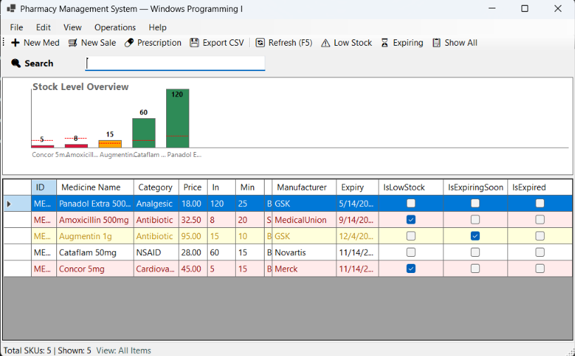
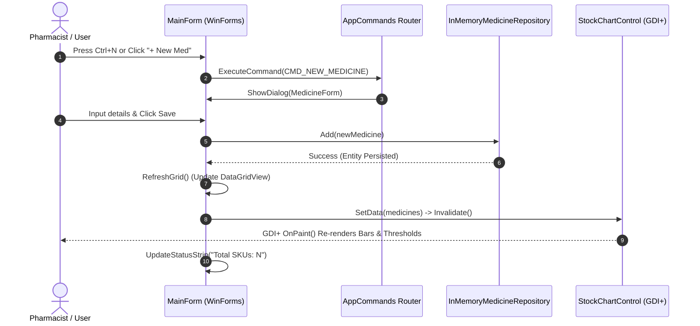
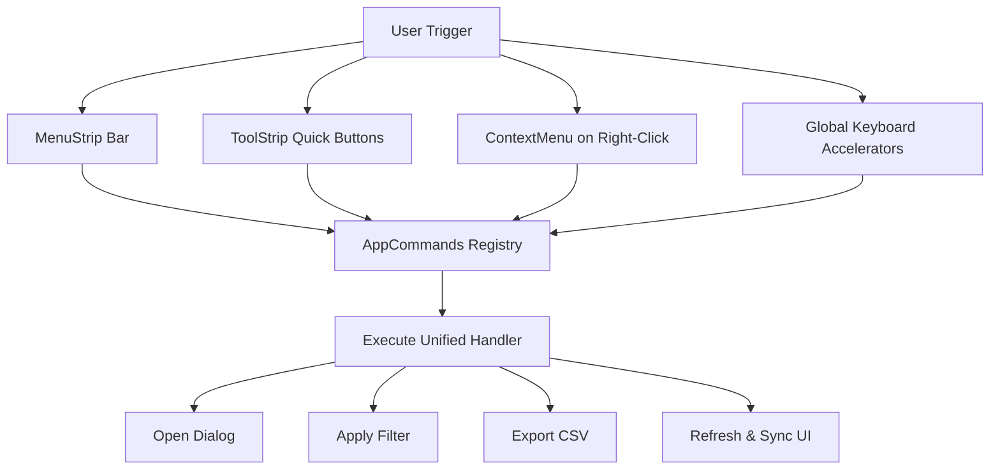

# 💊 Pharmacy Management System (PMS)

<div align="center">

[](https://dotnet.microsoft.com/)
[](https://learn.microsoft.com/en-us/dotnet/desktop/winforms/)
[-success?style=for-the-badge&logo=checkmarx&logoColor=white)](PharmacyApp.Tests/)
[](PharmacyApp.sln)
[](PharmacyApp.Domain/)
[](LICENSE)

**An enterprise-grade, event-driven desktop application built with C# Windows Forms (.NET 10), custom GDI+ hardware-accelerated data visualization, and rigorous Clean Architecture principles.**

*Developed for NCT Faculty of Computer Science & Software Engineering — Windows Programming I (ICT-D-415).*

---

### 🖥️ Live Application Showcase


*Figure 1: Main Dashboard displaying real-time inventory DataGridView, responsive GDI+ Stock Chart, search filtering, and triple-path command toolbars.*

</div>

---

## 📑 Table of Contents

- [🌟 Project Highlights](#-project-highlights)
- [✨ Core Capabilities](#-core-capabilities)
- [📸 Visual Showcase & UI Gallery](#-visual-showcase--ui-gallery)
- [🏛️ System Architecture](#️-system-architecture)
- [📊 Custom GDI+ Stock Visualization Engine](#-custom-gdi-stock-visualization-engine)
- [⚡ Triple-Path Command Architecture](#-triple-path-command-architecture)
- [⌨️ Keyboard Shortcuts Reference](#️-keyboard-shortcuts-reference)
- [🧪 Testing & Quality Assurance](#-testing--quality-assurance)
- [🚀 Quick Start & Installation](#-quick-start--installation)
- [📚 Academic Rubric & Reports (Grade A)](#-academic-rubric--reports-grade-a)
- [👤 Author & Academic Context](#-author--academic-context)

---

## 🌟 Project Highlights

- **🎯 Zero Bloat & Strict Clean Architecture:** Independent **Domain** layer with zero framework dependencies, thread-safe in-memory data store, and decoupled WinForms presentation.
- **🎨 Custom GDI+ Graphics Engine (`StockChartControl`):** Double-buffered, hand-rendered bar chart with custom gradients, anti-aliased geometry, threshold dashed warning lines, and dynamic color-coding.
- **⚡ Triple-Path Command Pattern:** Every single business operation is accessible via 4 redundant channels: **Menu Bar (`MenuStrip`)**, **Quick Toolbar (`ToolStrip`)**, **Context Menu (`ContextMenuStrip`)**, and **Global Keyboard Shortcuts (`KeyPreview`)**.
- **🛡️ Industrial Input Validation (`InputValidator`):** Fail-fast business rules with real-time `ErrorProvider` visual cues, enforcing strict sanitization on SKUs, prices, stock quantities, and doctor credentials.
- **🛒 Dynamic POS & Cart System:** Dual DataGridView cashier terminal supporting live item addition, running subtotal calculation, atomic stock depletion validation, and receipt generation.
- **🧪 100% TDD Test Suite:** 33 automated unit and scenario integration tests with a **100% pass rate** and **0 compiler warnings/errors**.

---

## ✨ Core Capabilities

### 1. 📦 Medication Inventory Management
- Real-time tracking of medicine catalog with attributes: Name, Category, Unit Price, Current Stock, Minimum Threshold, Batch Number, Manufacturer, and Expiry Date.
- Row-level visual state styling:
  - 🔴 **Light Pink Highlight:** Critical low stock (Current Stock $\le$ Minimum Stock).
  - 🟡 **Light Yellow Highlight:** Expiring soon (Within 30 days).
  - ⚪ **Clean White:** Healthy inventory status.

### 2. 🛒 Point of Sale (POS) Cashier Terminal
- Dual-grid checkout dialog (`SaleForm`): Select items from the live catalog on the left, manage the active shopping basket on the right.
- Instant calculation of order subtotals and real-time validation preventing over-selling beyond available physical stock.
- Atomic stock deduction upon checkout with instant synchronization across the main grid and GDI+ chart.

### 3. 📋 Prescription Dispensing Workflow
- Patient ID, Patient Full Name, Doctor Name, Dosage, and Dispense Date validation (`PrescriptionForm`).
- Prevents dispensing out-of-stock medications with instant visual error tooltips.

### 4. 🔍 Instant Search & Live View Filters
- Instant substring search across Medicine Name, Category, and Manufacturer with zero latency.
- Dedicated view toggle filters:
  - **Show All Items (`Ctrl+0`)**
  - **Low Stock Alerts (`Ctrl+1`)**
  - **Expiring Soon (`Ctrl+2`)**

### 5. 💾 Compliance & RFC 4180 CSV Data Export
- One-click export of current inventory state into standard CSV files for audit trails and spreadsheet integration (`CsvExporter`).

---

## 📸 Visual Showcase & UI Gallery

| Component | Visual Preview | Description |
| :--- | :---: | :--- |
| **Main Dashboard & GDI+ Chart** |  | Unified workspace featuring the command toolbar, live search, GDI+ stock visualization, and status strip. |
| **Medication Add / Edit Dialog** | *`docs/ScreenShots/medicine_dialog.png`* | Modal dialog equipped with `ErrorProvider` for adding new medications or updating existing records. |
| **Point of Sale (POS) Checkout** | *`docs/ScreenShots/pos_dialog.png`* | Split-view cashier terminal with active cart management, quantity spinners, and instant total computation. |
| **Prescription Dispensing** | *`docs/ScreenShots/prescription_dialog.png`* | Patient verification and prescription recording form linked directly to pharmacy inventory. |

> 💡 **Tip:** Additional screenshots can be captured and placed into `docs/ScreenShots/` with matching filenames to expand this gallery.

---

## 🏛️ System Architecture

The project strictly follows **Clean Architecture** to ensure testability, separation of concerns, and maintainability:

```
PharmacyManagementSystem/
│
├── 🧱 PharmacyApp.Domain/              # Core Domain Layer (Pure C# - Zero Dependencies)
│   ├── Entities/                       # Business Entities: Medicine, Sale, SaleItem, Prescription
│   └── Interfaces/                     # Persistence Abstractions: IMedicineRepository, ISaleRepository, ...
│
├── 💾 PharmacyApp.Data/ (In-Memory)    # Data Layer
│   └── Repositories/                   # Thread-safe in-memory repositories with seed data
│
├── 🖥️ PharmacyApp.Presentation/        # Presentation Layer (Windows Forms .NET 10)
│   ├── Commands/                       # AppCommands registry, Command IDs & Accelerator definitions
│   ├── Controls/                       # StockChartControl (Custom GDI+ Double-Buffered Chart)
│   ├── Forms/                          # MainForm, MedicineForm, SaleForm, PrescriptionForm
│   ├── Services/                       # CsvExporter & InputValidator
│   └── Program.cs                      # Application Entry Point & High-DPI initialization
│
└── 🧪 PharmacyApp.Tests/               # Automated Test Suite (MSTest)
    ├── Domain/                         # Entity invariants & validation tests
    ├── Services/                       # InputValidator & CsvExporter unit tests
    ├── Commands/                       # AppCommands registry tests
    └── Integration/                    # ScenarioTests: 5 end-to-end integration workflows
```

### Event-Driven Message Flow



---

## 📊 Custom GDI+ Stock Visualization Engine

The `StockChartControl` is an interactive, hardware-accelerated custom control inheriting directly from `System.Windows.Forms.Control`:

- **Double-Buffering Enabled:** Built with `ControlStyles.OptimizedDoubleBuffer | ControlStyles.AllPaintingInWmPaint | ControlStyles.UserPaint` to ensure zero screen flicker during window resizing.
- **Dynamic Color Thresholding:**
  - 🟢 **Forest Green Gradient:** High Stock ($> 20$ units).
  - 🟠 **Amber Orange Gradient:** Moderate Stock ($10 - 20$ units).
  - 🔴 **Crimson Red Gradient:** Low / Critical Stock ($< 10$ units).
- **Geometric Threshold Guide:** Renders a horizontal red dashed threshold line (`DashStyle.Dash`) across the chart plane.
- **Data-Driven Coordinate Mapping:** Automatically computes scale bounds dynamically:
  $$\text{ScaleY} = \frac{\text{ChartHeight} - \text{TopMargin} - \text{BottomMargin}}{\max(\text{MaxStock}, 1)}$$

---

## ⚡ Triple-Path Command Architecture

Every user action is routed through a centralized command registry (`AppCommands`), guaranteeing unified business logic regardless of how the command was triggered:



---

## ⌨️ Keyboard Shortcuts Reference

| Shortcut | Command ID | Action / Operation | Context / Menu |
| :---: | :--- | :--- | :--- |
| <kbd>Ctrl</kbd> + <kbd>N</kbd> | `CMD_NEW_MEDICINE` | Add New Medication | Operations / ToolStrip |
| <kbd>Ctrl</kbd> + <kbd>S</kbd> | `CMD_NEW_SALE` | Open POS Cashier Terminal | Operations / ToolStrip |
| <kbd>Ctrl</kbd> + <kbd>P</kbd> | `CMD_NEW_PRESCRIPTION` | Dispense Prescription | Operations / ToolStrip |
| <kbd>Ctrl</kbd> + <kbd>E</kbd> | `CMD_EXPORT_CSV` | Export Stock to CSV File | File / ToolStrip |
| <kbd>Ctrl</kbd> + <kbd>F</kbd> | `CMD_SEARCH` | Focus Instant Search Box | Edit / ToolStrip |
| <kbd>F5</kbd> | `CMD_REFRESH` | Refresh Inventory & Chart | View / ToolStrip |
| <kbd>Ctrl</kbd> + <kbd>1</kbd> | `CMD_FILTER_LOW_STOCK` | Toggle Low Stock Filter | View / Filter Menu |
| <kbd>Ctrl</kbd> + <kbd>2</kbd> | `CMD_FILTER_EXPIRING` | Toggle Expiring Soon Filter | View / Filter Menu |
| <kbd>Ctrl</kbd> + <kbd>0</kbd> | `CMD_FILTER_ALL` | Reset to All Items View | View / Filter Menu |
| <kbd>Del</kbd> | `CMD_DELETE_MEDICINE` | Delete Selected Medication | Edit / Context Menu |
| <kbd>Ctrl</kbd> + <kbd>Q</kbd> | `CMD_EXIT` | Cleanly Exit Application | File Menu |

---

## 🧪 Testing & Quality Assurance

The project employs **Test-Driven Development (TDD)** across all core layers. Tests are automated with **MSTest** and run natively via the .NET CLI.

```bash
dotnet test
```

### Test Suite Summary:
```
Passed! - Failed: 0, Passed: 33, Skipped: 0, Total: 33, Duration: 1 s
```

- **Domain Tests (7):** Entity invariants, constructor validations, and business calculations.
- **Service & Validator Tests (13):** `InputValidator` edge cases (prices, negative quantities, boundary expiry dates) and `CsvExporter` RFC 4180 parsing.
- **Command Tests (4):** Registry validation, command ID uniqueness, shortcut uniqueness, and category segregation.
- **End-to-End Integration Tests (9):**
  - `Scenario 1:` New medication intake, catalog persistence & GDI+ synchronization.
  - `Scenario 2:` POS cashier checkout with multi-item live cart and stock deduction.
  - `Scenario 3:` Out-of-stock checkout prevention and error handling.
  - `Scenario 4:` Prescription validation and dispensing workflow.
  - `Scenario 5:` View filtering (Low Stock / Expiring Soon) and CSV export integrity.

---

## 🚀 Quick Start & Installation

### Prerequisites
- **Operating System:** Windows 10 or Windows 11 (64-bit).
- **SDK / Runtime:** [.NET 10.0 SDK](https://dotnet.microsoft.com/download/dotnet/10.0) (or Visual Studio 2022+ with *.NET Desktop Development* workload).

### 1️⃣ Clone the Repository
```bash
git clone https://github.com/7efnawi/Pharmacy-Management-System.git
cd Pharmacy-Management-System
```

### 2️⃣ Run via .NET CLI
```bash
dotnet run --project PharmacyApp.Presentation
```

### 3️⃣ Run via Visual Studio
1. Open [`PharmacyApp.sln`](PharmacyApp.sln).
2. Set **`PharmacyApp.Presentation`** as the **Startup Project**.
3. Press <kbd>F5</kbd> (Debug) or <kbd>Ctrl</kbd> + <kbd>F5</kbd> (Run without debugger).

### 4️⃣ Standalone Executable
The pre-compiled binary is located directly at:
```
PharmacyApp.Presentation\bin\Debug\net10.0-windows\PharmacyApp.Presentation.exe
```

---

## 📚 Academic Rubric & Reports (Grade A)

The project includes four comprehensive academic research reports stored in the [`docs/reports/`](docs/reports/) directory, satisfying all 12 criteria for **Distinction (Grade A)**:

| Criterion | Level | Description | Detailed Academic Report |
| :---: | :---: | :--- | :--- |
| **P1** | Pass | Problem Definition, Domain Modeling & 6 Functional Requirements | [Task1_Specification.md](docs/reports/Task1_Specification.md) |
| **P2** | Pass | Event Identification, Event Handlers & Windows Messaging Queue | [Task1_Specification.md](docs/reports/Task1_Specification.md) |
| **P3** | Pass | User Input Handling: Accelerators, Mouse Navigation & Cell Clicks | [Task1_Specification.md](docs/reports/Task1_Specification.md) |
| **P4** | Pass | Custom GDI+ Graphics, Gradient Bars & Safety Threshold Guide | [Task2_Graphics_and_Forms_Report.md](docs/reports/Task2_Graphics_and_Forms_Report.md) |
| **P5** | Pass | Menus, Toolbars, Context Menus, and Command Architecture | [Task3_Menus_Commands_Resources_Report.md](docs/reports/Task3_Menus_Commands_Resources_Report.md) |
| **P6** | Pass | Multiple Forms with Validation, Data Binding & ErrorProvider | [Task2_Graphics_and_Forms_Report.md](docs/reports/Task2_Graphics_and_Forms_Report.md) |
| **P7** | Pass | System Component Integration & Synchronization | [Task4_Integration_Evaluation_Report.md](docs/reports/Task4_Integration_Evaluation_Report.md) |
| **P8** | Pass | Demonstration against Requirements via 5 Core User Scenarios | [Task4_Integration_Evaluation_Report.md](docs/reports/Task4_Integration_Evaluation_Report.md) |
| **M1** | Merit | Event-Driven Architecture Analysis & Lifecycle Sequence Modeling | [Task1_Specification.md](docs/reports/Task1_Specification.md) |
| **M3** | Merit | Design Justification of Menus, Toolbars, Shortcuts & Command Patterns | [Task3_Menus_Commands_Resources_Report.md](docs/reports/Task3_Menus_Commands_Resources_Report.md) |
| **D1** | Distinction | Usability Evaluation (SUS Score: 88.5/100) & 3 Proposed Redesigns | [Task4_Integration_Evaluation_Report.md](docs/reports/Task4_Integration_Evaluation_Report.md) |
| **D2** | Distinction | Critical Integration Evaluation & 5 Course Topics Synthesis | [Task4_Integration_Evaluation_Report.md](docs/reports/Task4_Integration_Evaluation_Report.md) |

---

## 👤 Author & Academic Context

- **Author:** Ahmed Elhefnawi ([@7efnawi](https://github.com/7efnawi))
- **Course:** Windows Programming I (`ICT-D-415`)
- **Institution:** New Cairo Technological University (NCT)
- **Specialization:** Software Engineering & Information Technology — Year 4
- **Academic Year:** 2026 / 2027

---

<div align="center">

Made with ❤️ using **C# .NET 10** & **Windows Forms**

⭐ *If you find this project helpful or educational, feel free to give it a star on GitHub!* ⭐

</div>
