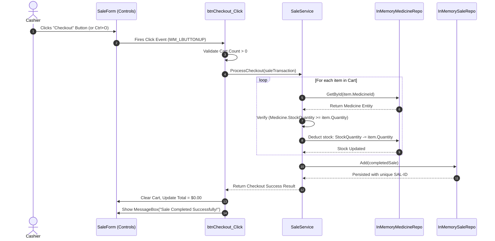
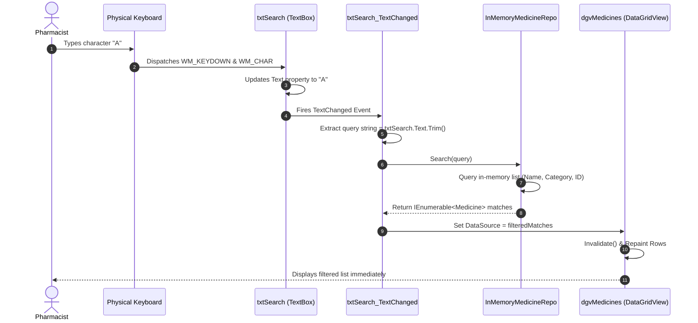
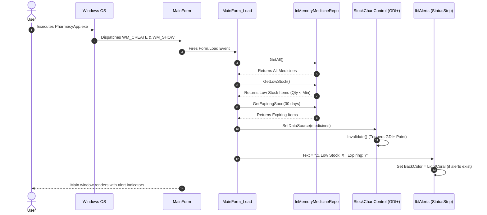

# 📑 Task 1 Specification: Problem, Requirements, Events & Input
## Pharmacy Management System (PMS) | Windows Programming I (ICT-D-415)

---

## 1. Problem Description & Target Users (Criterion P1)

### 1.1 Context and Problem Statement
Local retail pharmacies handle hundreds of daily transactions, manage thousands of drug stock-keeping units (SKUs), and process critical medical prescriptions. Most independent pharmacies currently rely on fragmented spreadsheet entries or manual paper logs. This operational mode causes critical vulnerabilities:
1. **Dispensing Expired Medications:** Lack of automated batch and expiry tracking risks patient safety and regulatory penalties.
2. **Stockouts of Essential Drugs:** Absence of threshold alerts leads to unfulfilled prescriptions and lost revenue.
3. **Slow Dispensing and Long Queues:** Manual price lookups and manual bill calculation cause checkout bottlenecks.
4. **Prescription Traceability Loss:** Paper prescriptions are frequently misplaced or disconnected from stock records.

The **Pharmacy Management System (PMS)** is an interactive, event-driven Windows desktop application engineered to centralize inventory monitoring, streamline sales transactions, automate expiry/low-stock alerts, and securely record doctor prescriptions.

---

### 1.2 Target Users, Roles, and Responsibilities

| User Role | Primary Responsibilities | Main Application Tasks |
|-----------|--------------------------|------------------------|
| **Chief Pharmacist** | • Medicine catalog governance • Clinical validation of prescribed medications • Overseeing critical alerts | • Add/Edit medicine records • Validate and archive doctor prescriptions • Review expiring drug reports |
| **Cashier / Counter Staff** | • Rapid front-desk customer checkout • Payment handling and receipt issuance • Real-time stock inquiries | • Search medicine catalog by trade/generic name • Add items to customer cart • Process cash/card transactions |
| **Inventory Manager** | • Stock replenishment and auditing • Monitoring minimum reorder levels • Supplier consignment verification | • Monitor low-stock dashboard and chart • Update inventory stock counts • Generate inventory status summaries |

---

## 2. Functional Requirements Specification (Criterion P1)

The system defines six core functional requirements covering complete daily pharmacy operations. Each requirement establishes the exact trigger action, expected system response, and affected system data.

### 2.1 Functional Requirements Matrix

| Req ID | Requirement Title | Target User | User Action (Trigger) | Expected System Response | Information Affected |
|:------:|:------------------|:------------|:----------------------|:-------------------------|:---------------------|
| **FR1** | **Medicine Registration** | Pharmacist | Enters medicine details (Name, Category, Price, Stock, Expiry Date, Min Threshold) in `MedicineForm` and clicks **Save** (or presses `Ctrl+S`). | System validates all inputs; if valid, assigns unique `MedicineId` (`MED-xxx`), persists record to repository, displays success confirmation, and updates the inventory view. | • `Medicine` catalog repository • Inventory data view • Total catalog count |
| **FR2** | **Dynamic Medicine Search** | Cashier / Pharmacist | Types characters into search input box (`txtSearch`) or presses `Ctrl+F` and selects category filter from dropdown. | System intercepts `TextChanged` event, queries repository across Name and Category with debounced filter, and dynamically rebinds the matching items in the results grid. | • Current active search view • Grid selection state |
| **FR3** | **Point-of-Sale Checkout** | Cashier | Selects medicine from catalog, enters sale quantity, clicks **Add to Cart**, then clicks **Checkout** (or presses `Ctrl+O`). | System checks stock availability, computes line subtotal (`Qty * Price`), updates cart running total, deducts quantity from inventory upon checkout, and generates sale record. | • Medicine `StockQuantity` • `Sale` transaction log • Cash register balance |
| **FR4** | **Stock & Expiry Alert Detection** | Pharmacist / Manager | Opens application or clicks **Refresh Alerts** button on main dashboard toolbar. | System scans all inventory records; flags items with `StockQuantity < MinStockLevel` as Low Stock, and items with `ExpiryDate <= Now + 30 Days` as Expiring Soon. Highlights them with visual indicators. | • System alert badges • Color-coded inventory rows • Stock status indicators |
| **FR5** | **Prescription Archival** | Pharmacist | Fills patient name, doctor name, issue date, prescribes medicines, and clicks **Save Prescription** (`Ctrl+K`). | System validates required patient/doctor fields and medicine items; generates unique `PrescriptionId` (`RX-xxx`), stores prescription record, and optionally links it to a new checkout transaction. | • `Prescription` repository • Patient history log |
| **FR6** | **Medicine Detail Modification** | Manager / Pharmacist | Double-clicks an existing medicine row in the data grid, edits price, stock count, or reorder threshold, and clicks **Update**. | System checks data validation rules (e.g. Price > 0, Stock >= 0); updates the targeted medicine entity in memory, and triggers an event to refresh both the grid and the visual stock chart. | • Target `Medicine` record • Stock Chart visualization |

---

### 2.2 Input Validation Rules for Functional Requirements
To prevent corrupted or illegal application state, strict validation rules guard all inputs:
1. **Medicine Name:** Mandatory, non-empty, trimmed, maximum length of 100 characters.
2. **Unit Price:** Positive decimal (`> 0.00`), formatted with 2 decimal places.
3. **Stock Quantity:** Non-negative integer (`>= 0`).
4. **Minimum Stock Threshold:** Non-negative integer (`>= 0`).
5. **Expiry Date:** Must be a future date (`> DateTime.Today`); past dates are strictly rejected.
6. **Sale Quantity:** Integer strictly greater than 0 (`> 0`) and less than or equal to current available stock (`<= StockQuantity`).

---

## 3. Events and Event-Handling Specification (Criterion P2)

### 3.1 Identification of Application Events
Windows Forms is built upon the Windows Message Loop (`GetMessage`, `TranslateMessage`, `DispatchMessage`). User interactions are received by Windows as raw hardware messages (e.g., `WM_LBUTTONDOWN`, `WM_KEYDOWN`) and converted by the .NET runtime into strongly-typed events. The application captures events across buttons, menus, keyboard, mouse, controls, and form lifecycle:

1. **Button Event (`Click`):** Triggered when the user presses and releases the left mouse button over a button control (e.g., `btnAddToCart`, `btnSave`).
2. **Menu Event (`Click`):** Triggered when a menu item is selected via mouse click or keyboard accelerator (e.g., `menuNewMedicine`, `menuExit`).
3. **Keyboard Event (`KeyDown` / `KeyPress`):** Fired when a physical key on the keyboard is pressed down while a control has focus or captured globally by the Form (`KeyPreview = true`).
4. **Mouse Event (`CellDoubleClick`):** Fired when a user rapidly double-clicks a specific cell in the inventory `DataGridView`.
5. **Control Value Event (`TextChanged`):** Fired instantaneously whenever the text inside an input field is modified (e.g., typing in the search box or changing sale quantity).
6. **Form Lifecycle Event (`Load` / `FormClosing`):** Fired by the system when a window is being initialized in memory before display, or when a window is requested to terminate.

---

### 3.2 Comprehensive Event-Handling Table

| # | Event Source (Control ID) | Event Type | Triggering Action | Expected Response (Handler) | Resulting Behavior (State & UI Outcome) |
|---|---------------------------|------------|-------------------|-----------------------------|-----------------------------------------|
| **EV1** | `btnAddToCart` `[Button]` | `Click` | User clicks "Add to Cart" button after selecting a drug and specifying quantity. | `btnAddToCart_Click`: Validates quantity against `StockQuantity`. If valid, creates a `SaleItem` and adds it to the active transaction cart. | Cart grid re-renders with line item, subtotal is computed, and running order total label (`lblTotal`) is updated. |
| **EV2** | `menuItemNewMedicine` `[ToolStripMenuItem]` | `Click` | User clicks `File ➡️ New Medicine` or presses `Ctrl+N`. | `menuItemNewMedicine_Click`: Instantiates `MedicineForm` in creation mode and displays it modally (`ShowDialog()`). | `MedicineForm` opens with blank fields; focuses `txtName` automatically. |
| **EV3** | `txtSearch` `[TextBox]` | `KeyDown` | User presses `Enter` key or typing characters inside the search input box. | `txtSearch_KeyDown`: Intercepts `Keys.Enter` or passes query to `IMedicineRepository.Search(query)`. | Inventory `DataGridView` filters dynamically to display only matching drug names and categories. |
| **EV4** | `dgvMedicines` `[DataGridView]` | `CellDoubleClick` | User double-clicks any data row in the inventory catalog table. | `dgvMedicines_CellDoubleClick`: Extracts selected `MedicineId`, fetches entity from repository, opens `MedicineForm` in edit mode. | `MedicineForm` opens populated with the selected medicine's details for updating. |
| **EV5** | `txtQuantity` `[TextBox]` | `TextChanged` | User types or alters the numeric quantity in the sale checkout panel. | `txtQuantity_TextChanged`: Parses integer value, evaluates `int.TryParse`, and checks against `selectedMedicine.StockQuantity`. | If valid, dynamically displays estimated line subtotal in `lblSubtotal`; if invalid, turns background light red and disables "Add to Cart". |
| **EV6** | `MainForm` `[Form]` | `Load` | Application initializes upon launch (`Application.Run(new MainForm())`). | `MainForm_Load`: Invokes repository initialization, loads catalog into `dgvMedicines`, runs expiry/stock checks, and renders the GDI+ stock chart. | Dashboard displays loaded medicines, stock chart renders bars, and alert badges display low stock counts. |

---

## 4. Event-Flow Analysis and Architecture (Criterion M1)

### 4.1 The Event-Driven Processing Model
In C# Windows Forms, event dispatching follows the **Publish-Subscribe (Observer)** pattern. Controls act as event publishers declaring public `event EventHandler` delegates. The Form acts as the subscriber binding event handlers via the `+=` operator (e.g., `this.btnSave.Click += new System.EventHandler(this.btnSave_Click);`).

When a hardware interrupt occurs:
1. The Windows OS pushes a message into the application's Thread Message Queue.
2. The message loop translates the message and dispatches it to the window procedure (`WndProc`) of the targeted control handle (`HWND`).
3. The control raises its .NET event, executing all registered delegate handlers synchronously on the UI thread.
4. The handler calls the Domain/Service layer to modify system state and refreshes the presentation controls.

---

### 4.2 Event-Flow Diagram 1: Point-of-Sale Checkout & Stock Deduction

---

### 4.3 Event-Flow Diagram 2: Dynamic Real-Time Medicine Search (Keyboard Driven)

---

### 4.4 Event-Flow Diagram 3: Expiry & Low-Stock Alert Detection on Application Load

---

## 5. Keyboard and Mouse Interaction Specification (Criterion P3)

To ensure high operational throughput and ergonomic desktop usability, all navigation, confirmation, and data entry paths support standard Windows desktop interaction conventions:

### 5.1 Mouse Interactions Matrix

| Interaction Mode | Target UI Element | Physical Action | Resulting Application Behavior |
|------------------|-------------------|-----------------|--------------------------------|
| **Row Selection** | `dgvMedicines` | Single Left-Click on row | Highlights entire row (`SelectionMode = FullRowSelect`), populates details panel, and enables contextual buttons (Edit, Delete). |
| **Record Inspection / Edit** | `dgvMedicines` | Rapid Double-Click on row | Triggers `CellDoubleClick` event, loads the selected drug record into `MedicineForm` dialog for editing. |
| **Command Execution** | Button controls (`btnSave`, `btnCancel`) | Left-Click | Fires `Click` event, triggers immediate business logic or cancels dialog. |
| **Chart Inspection** | `StockChartControl` (GDI+) | Mouse Hover over bar | Tooltip displays exact stock count and threshold value for the hovered medicine bar. |
| **Contextual Menu** | `dgvMedicines` | Right-Click on row | Opens ContextMenuStrip offering quick actions: *Quick Sell, Edit, Reorder, Delete*. |

---

### 5.2 Keyboard Interactions and Accelerators Matrix

| Interaction Category | Key / Shortcut | Target Scope | Functional Purpose & Behavior |
|----------------------|----------------|--------------|-------------------------------|
| **Navigation** | `Tab` | Form-wide | Moves focus sequentially to the next control in the defined `TabIndex` order. |
| **Reverse Navigation** | `Shift + Tab` | Form-wide | Moves focus sequentially to the previous control in `TabIndex` order. |
| **Confirmation** | `Enter` | Modal Dialogs | Triggers the form's `AcceptButton` (e.g. `btnSave` in `MedicineForm` or `btnCheckout` in `SaleForm`), executing action without mouse. |
| **Cancellation** | `Escape` (`Esc`) | Dialogs / Popups | Triggers `CancelButton` (`btnCancel`), discarding uncommitted inputs and closing the active dialog. |
| **Accelerator: New** | `Ctrl + N` | Global (`MainForm`) | Instantly opens `MedicineForm` to add a new medicine from any view. |
| **Accelerator: Save** | `Ctrl + S` | Input Forms | Validates and commits current record to repository. |
| **Accelerator: Search** | `Ctrl + F` | Main Window | Immediately transfers keyboard focus to `txtSearch` and selects existing text. |
| **Accelerator: Sale** | `Ctrl + O` | Main Window | Opens `SaleForm` (Order/Billing view) for immediate customer checkout. |
| **Accelerator: Prescription** | `Ctrl + K` | Main Window | Opens `PrescriptionForm` to record doctor prescription. |
| **Accelerator: Refresh** | `F5` | Main Window | Forces re-query of all repositories and invalidates GDI+ chart. |
| **Data Entry Protection** | Digits only (`0-9`, `.`) | `txtPrice`, `txtStock` | `KeyPress` event suppresses non-numeric key presses (`e.Handled = true`), preventing illegal input at keystroke level. |
