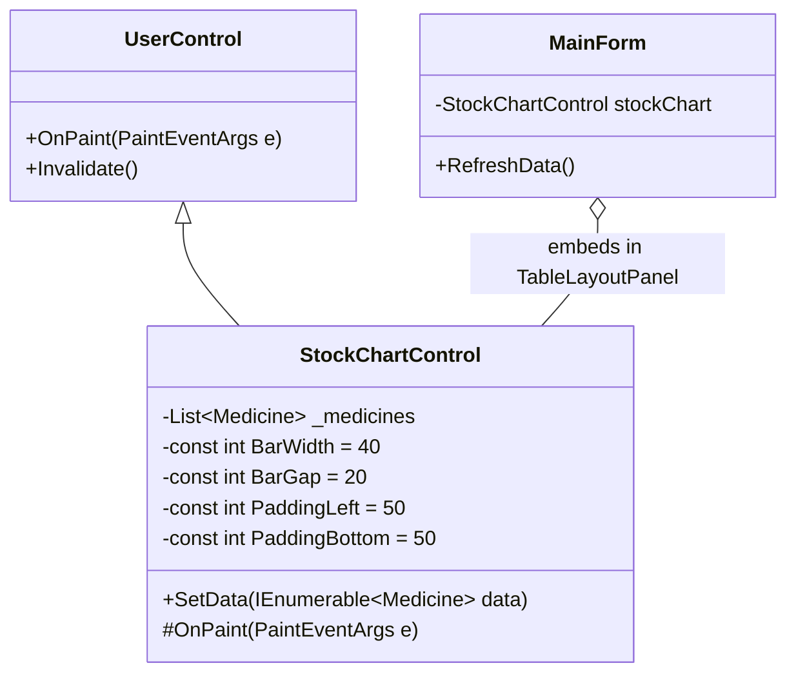

# 📑 Task 2 Specification & Engineering Report: Graphics & Drawing, Forms & Input Validation
## Pharmacy Management System (PMS) | Windows Programming I (ICT-D-415)
### Academic Coverage: Criteria P4 & P6 (Sections 7–13)

---

## Executive Summary

This report documents the architectural design, implementation, and verification of **Task 2** for the Pharmacy Management System (PMS). It rigorously satisfies two major grading criteria established in the course syllabus:
1. **Criterion P4 (Graphics & Drawing):** Implementation of a functional GDI+ custom graphical UserControl (`StockChartControl`) that dynamically visualizes inventory stock levels against defined reorder thresholds in response to repository events.
2. **Criterion P6 (Forms & User Input):** Implementation of three fully functional Windows dialog forms (`MedicineForm`, `SaleForm`, and `PrescriptionForm`), detailed with comprehensive Control Specification Tables, standard Windows dialog interaction patterns, and five robust input validation rules verified through automated Test-Driven Development (TDD).

---

# PART 1: Graphics & Drawing (Criterion P4)

## 1. Purpose of the Graphical Element (Section 7)

### 1.1 Clinical and Operational Context
In a busy retail pharmacy dispensing hundreds of prescriptions daily, pharmacists cannot afford to scrutinize tabular numerical grids to detect drug shortages. An unexpected stockout of an essential antibiotic or cardiac medication poses an immediate threat to patient care. 

The **Stock Level Overview Chart (`StockChartControl`)** provides an immediate, cognitive-first visual dashboard rendered at the top of the application's main workspace. It continuously translates raw stock integers into an intuitive visual bar diagram where bar heights and colors represent clinical urgency.

### 1.2 Core Objectives
- **At-a-glance Awareness:** Allow pharmacy staff to instantly identify depleted items without reading rows of numerical quantities.
- **Visual Threshold Juxtaposition:** Draw a physical visual barrier (minimum threshold line) against each drug's current stock to highlight deficits.
- **Event-Driven Reactivity:** The chart does not use polling timers; it re-renders immediately whenever the underlying inventory state changes (e.g., after adding a new medicine, editing details, or completing a sales transaction).

---

## 2. Graphical Design Decisions & GDI+ Architecture (Section 8)

### 2.1 Component Architecture: Custom `UserControl`
Rather than embedding drawing logic directly inside `MainForm.Paint`, the chart is encapsulated inside a reusable `System.Windows.Forms.UserControl` subclass: `StockChartControl`. This conforms to the **Single Responsibility Principle (SRP)**:
- `StockChartControl` owns graphics calculation, color mapping, and coordinate transformations.
- `MainForm` acts as the host container, passing data snapshots via `SetData(IEnumerable<Medicine>)`.



### 2.2 Flicker Elimination & Rendering Optimizations
GDI+ graphics can suffer from noticeable visual flickering when controls redraw during form resizing or data updates. `StockChartControl` eliminates flickering through two critical WinForms optimizations configured in its constructor:
```csharp
public StockChartControl()
{
    DoubleBuffered = true;  // Uses an off-screen memory buffer before blitting to screen
    ResizeRedraw = true;    // Automatically invalidates and repaints when parent container resizes
}
```

### 2.3 Visual Encoding & Mathematical Coordinate Mapping
The GDI+ rendering pipeline in `OnPaint` implements precise coordinate transformations:
1. **Dynamic Scaling:** Calculates `maxStock = Max(StockQuantity, MinStockLevel)` across visible items to establish the Y-axis ceiling.
2. **Height Proportion:** `barHeight = (StockQuantity / maxStock) * (Height - PaddingTop - PaddingBottom)`.
3. **Y-Axis Inversion:** Because GDI+ origin `(0, 0)` is at the top-left, the top of each bar is computed as:
   $$\text{barTop} = \text{Height} - \text{PaddingBottom} - \text{barHeight}$$
4. **Three-Tier Semantic Color Palette:**
   - 🟢 **Sea Green (`Color.SeaGreen`):** Stock is healthy ($\ge 150\%$ of minimum threshold).
   - 🟠 **Orange (`Color.Orange`):** Stock is in the cautionary warning zone (between $100\%$ and $150\%$ of minimum threshold).
   - 🔴 **Crimson (`Color.Crimson`):** Critical deficit ($\text{StockQuantity} < \text{MinStockLevel}$).
5. **Dashed Threshold Reference Line:**
   A distinct red dashed line (`DashStyle.Dash`) is drawn across the width of each bar at the exact Y coordinate corresponding to that medicine's `MinStockLevel`:
   $$\text{minY} = \text{Height} - \text{PaddingBottom} - \left(\frac{\text{MinStockLevel}}{\text{maxStock}} \times \text{chartHeight}\right)$$

---

## 3. Annotated Visual Mock-up Description: Three Chart States (Section 9)

Below is an annotated description of how the `StockChartControl` visually presents three operational states of the pharmacy:

### State A: Healthy Inventory Baseline
```
  Stock Level Overview
   Y |
 100 |     [120]      [85]       [60]       [95]
     |     |   |      |  |       |  |       |  |
     |     | █ |      | █|       | █|       | █|
  20 | - - - - -    - - - -    - - - -    - - - -  <-- Dashed Reorder Line
     |     | █ |      | █|       | █|       | █|
   0 +-----+---+------+--+-------+--+-------+--+----- X
          Amoxicil   Panadol    Zyrtec     Ibuprofen
          (Green)    (Green)    (Green)    (Green)
```
- **Visual Appearance:** All bars are tall, solid **Sea Green**, and rise significantly above the horizontal red dashed threshold lines.
- **System Interpretation:** Healthy operating condition; no purchasing orders required.

### State B: Operating Warning State (Cautionary Depletion)
```
  Stock Level Overview
   Y |
 100 |     [120]
     |     |   |
  30 |     | █ |      [28]       [22]
  20 | - - - - -    - - - -    - - - -             <-- Dashed Reorder Line
  15 |     | █ |      | █|       | █|       [8]
     |     | █ |      | █|       | █|     - - - -  <-- Min Level (15)
     |     | █ |      | █|       | █|       | █|
   0 +-----+---+------+--+-------+--+-------+--+----- X
          Amoxicil   Panadol    Zyrtec     Omeprazole
          (Green)    (Orange)   (Orange)    (Crimson)
```
- **Visual Appearance:** `Panadol` and `Zyrtec` bars turn **Orange** as their stock falls between 1x and 1.5x of minimum level. `Omeprazole` dips below its dashed line (8 units vs 15 min) and turns bright **Crimson**.
- **System Interpretation:** Visual alert signals the inventory manager to prepare replenishment orders for Omeprazole and watch Panadol demand.

### State C: Critical Restocking & Emergency Shortage
```
  Stock Level Overview
   Y |
  50 |
  25 | - - - - -    - - - -    - - - -    - - - -  <-- Dashed Reorder Lines (25)
  10 |     [10]       [4]        [2]        [0]
     |     | █ |      | █|       | █|        |
   0 +-----+---+------+--+-------+--+-------+--+----- X
          Insulin    Salbutam   Metformin  Aspirin
          (Crimson)  (Crimson)  (Crimson)  (Crimson)
```
- **Visual Appearance:** Multiple bars are short, bright **Crimson**, and completely submerged under the red dashed threshold lines. `Aspirin` has a bar height of zero with a dashed red line hovering above the empty axis.
- **System Interpretation:** Critical shortage across multiple vital lines; pharmacy cannot fulfill certain prescriptions without emergency wholesale deliveries.

---

# PART 2: Forms & Controls Specification (Criterion P6)

## 4. Overview of the Three Interactive Dialog Forms (Section 10)

The system introduces three dedicated Windows Forms, each mapped to a distinct operational use case. All forms follow the standard Windows modal dialog pattern:
1. **`MedicineForm` (Form 1):** Manages drug registration and catalog updates. Features dual operational modes:
   - *Add Mode:* Triggered via `Ctrl+N` or menu; fields start empty with sensible defaults.
   - *Edit Mode:* Triggered via DataGridView double-click; pre-populates existing SKU attributes for editing.
2. **`SaleForm` (Form 2):** Point-of-Sale (POS) dispensing interface. Features a live dual-grid layout: available medicine catalog on the left, customer cart on the right. Updates running subtotal and total dynamically and decrements inventory atomically upon checkout.
3. **`PrescriptionForm` (Form 3):** Clinical archival interface. Records prescribing physician, patient identity, issuance date, and prescribed drug items with instructions.

---

## 5. Control Specification Tables (Sections 11 & 12)

### 5.1 Form 1: `MedicineForm` Control Specification

| Control Name | Control Type | Purpose | Input / Output | Validation Rule & Constraints | Key Handling / Shortcut |
|:---|:---|:---|:---:|:---|:---:|
| `lblTitle` | `Label` | Displays dialog header | Output | Static header text | — |
| `txtName` | `TextBox` | Medicine trade / generic name | Input | Mandatory; trimmed length $1 \le L \le 100$ | TabIndex = 0; AutoFocus |
| `cboCategory` | `ComboBox` | Drug pharmacological class | Input | Mandatory; selection required from preset list | DropDownList; TabIndex = 1 |
| `txtManufacturer` | `TextBox` | Pharmaceutical manufacturer | Input | Mandatory; non-empty string | TabIndex = 2 |
| `txtPrice` | `TextBox` | Unit retail price ($) | Input | Decimal number strictly $> 0.00$ | KeyPress filters non-numeric; TabIndex = 3 |
| `txtStock` | `TextBox` | Current on-hand quantity | Input | Non-negative integer $\ge 0$ | KeyPress filters non-digits; TabIndex = 4 |
| `txtMinStock` | `TextBox` | Minimum reorder alert level | Input | Non-negative integer $\ge 0$ | KeyPress filters non-digits; TabIndex = 5 |
| `dtpExpiry` | `DateTimePicker` | Drug expiration date | Input | Date strictly in the future ($> \text{Today}$) | Short Date format; TabIndex = 6 |
| `cboUnit` | `ComboBox` | Unit of measurement (Box, Bottle...) | Input | Mandatory; selection required | DropDownList; TabIndex = 7 |
| `lblError` | `Label` | Displays inline validation feedback | Output | Red text; hidden when form is valid | Dynamic visibility |
| `btnSave` | `Button` | Persists record and returns OK | Action | All 5+ validation rules must pass | `AcceptButton` (fires on Enter); TabIndex = 8 |
| `btnCancel` | `Button` | Aborts editing without saving | Action | None | `CancelButton` (fires on Esc); TabIndex = 9 |

---

### 5.2 Form 2: `SaleForm` (Point-of-Sale Checkout) Control Specification

| Control Name | Control Type | Purpose | Input / Output | Validation Rule & Constraints | Key Handling / Shortcut |
|:---|:---|:---|:---:|:---|:---:|
| `txtSearch` | `TextBox` | Live filter for available medicine catalog | Input | Optional; real-time `TextChanged` filter | TabIndex = 0; AutoFocus |
| `dgvAvailable` | `DataGridView` | Displays selectable in-stock medicines | Output | Read-only; full row selection | TabIndex = 1 |
| `txtQuantity` | `TextBox` | Desired purchase quantity | Input | Integer $1 \le \text{Qty} \le \text{RemainingStock}$ | KeyPress filters non-digits; TabIndex = 2 |
| `btnAddToCart` | `Button` | Transits item from catalog to cart | Action | Medicine selected and quantity valid | TabIndex = 3 |
| `dgvCart` | `DataGridView` | Displays active items in checkout cart | Output | Read-only; displays Item, Qty, Price, Subtotal | TabIndex = 4 |
| `btnRemoveItem` | `Button` | Removes selected line item from cart | Action | Row must be selected in `dgvCart` | TabIndex = 5 |
| `cboPayment` | `ComboBox` | Payment method (Cash, Card, Insurance) | Input | Mandatory selection | DropDownList; TabIndex = 6 |
| `lblTotal` | `Label` | Running sum of cart line items | Output | Auto-computed: $\sum \text{Subtotal}$ | Bold Green display |
| `lblError` | `Label` | Displays error warnings | Output | Visible only upon validation failure | Red text warning |
| `btnCheckout` | `Button` | Validates cart, deducts stock, closes OK | Action | Cart count $> 0$ and payment selected | `AcceptButton` (Enter); TabIndex = 7 |
| `btnCancel` | `Button` | Discards cart without stock deduction | Action | None | `CancelButton` (Esc); TabIndex = 8 |

---

### 5.3 Form 3: `PrescriptionForm` Control Specification

| Control Name | Control Type | Purpose | Input / Output | Validation Rule & Constraints | Key Handling / Shortcut |
|:---|:---|:---|:---:|:---|:---:|
| `txtPatientName` | `TextBox` | Full legal name of patient | Input | Mandatory; non-empty; $\le 100$ characters | TabIndex = 0; AutoFocus |
| `txtDoctorName` | `TextBox` | Prescribing physician name | Input | Mandatory; non-empty; $\le 100$ characters | TabIndex = 1 |
| `dtpDate` | `DateTimePicker` | Prescription issuance date | Input | Date cannot be in the future ($\le \text{Today}$) | TabIndex = 2 |
| `cboMedicines` | `ComboBox` | Prescribed drug selection | Input | Must select a valid catalog item | DropDownList; TabIndex = 3 |
| `txtQuantity` | `TextBox` | Prescribed unit quantity | Input | Positive integer $\ge 1$ | KeyPress filters non-digits; TabIndex = 4 |
| `btnAddItem` | `Button` | Appends drug to prescription list | Action | Validates medicine and positive quantity | TabIndex = 5 |
| `btnRemoveItem` | `Button` | Removes line item from prescription | Action | Item must be selected in items grid | TabIndex = 6 |
| `dgvItems` | `DataGridView` | Prescribed medication items grid | Output | Shows ID, Name, Quantity, Unit Price | TabIndex = 7 |
| `txtNotes` | `TextBox` | Clinical dosage instructions & notes | Input | Optional multiline text | Multiline = true; TabIndex = 8 |
| `lblError` | `Label` | Displays validation failures | Output | Visible only upon failure | Red text warning |
| `btnSave` | `Button` | Archives prescription record | Action | Patient, doctor, and $\ge 1$ item required | `AcceptButton` (Enter); TabIndex = 9 |
| `btnCancel` | `Button` | Aborts archival | Action | None | `CancelButton` (Esc); TabIndex = 10 |

---

# PART 3: Input Validation Rules & Defense Mechanisms (Section 13)

## 6. Comprehensive Input Validation Architecture

To safeguard data integrity across the pharmacy system, a defense-in-depth approach is adopted combining:
1. **Keystroke Interception (`KeyPress` Event):** Prevents invalid characters from appearing in textboxes before they are submitted.
2. **Centralized Static Helper (`InputValidator`):** Pure C# domain-level validation methods decoupled from UI controls, enabling automated unit testing.
3. **Form-Level Submission Gate:** Validates business rules when the user clicks Save/Checkout or presses `Enter`; displays inline visual error labels and focuses the offending control.

### 6.1 Validation Rules Matrix

| Rule # | Target Field | Valid Input Specification | Invalid Input Example | Defensive Mechanism | Exact Error Message Displayed |
|:---:|:---|:---|:---|:---|:---|
| **VR1** | **Medicine Name** | Non-empty string; maximum 100 characters. | `""` (Empty string or whitespace only) | Inline check on save; aborts save and focuses `txtName`. | `"Medicine name is required and cannot be empty."` |
| **VR2** | **Unit Price** | Parseable decimal strictly $> 0.00$. | `"-15.50"` or `"0.00"` or `"abc"` | `KeyPress` blocks letters; `InputValidator.ValidatePrice` blocks zero/negative. | `"Price must be greater than zero."` |
| **VR3** | **Stock / Min Level** | Parseable integer $\ge 0$. | `"-5"` or `"2.5"` | `KeyPress` blocks decimal points and negative signs; validator rejects $< 0$. | `"Stock quantity cannot be negative."` |
| **VR4** | **Expiry Date** | Calendar date strictly $> \text{Today}$. | Any date $\le \text{Today}$ (e.g. yesterday) | `dtpExpiry.MinDate` set to tomorrow; validator enforces future date. | `"Expiry date must be a future date (after today)."` |
| **VR5** | **Sale Quantity** | Positive integer $1 \le Q \le \text{RemainingStock}$. | `"0"`, `"-2"`, or `"50"` when only 10 in stock | `KeyPress` blocks non-digits; validator compares quantity against available stock. | `"Quantity (50) exceeds available stock (10)."` |
| **VR6** | **Patient / Doctor** | Non-empty strings; max 100 characters. | `""` or string $> 100$ characters | Form submit check; blocks save and highlights text field. | `"Patient name is required."` / `"Doctor name is required."` |
| **VR7** | **Cart / Rx Items** | Collection count $\ge 1$ item. | Checkout or Save with 0 items | Checkout and Save handlers inspect collection count before proceeding. | `"Cart is empty. Add at least one medicine before checkout."` |

---

## 7. Automated Test Verification (TDD Evidence)

In adherence with **Rule 2 (Verification & TDD First)** of the AGENTS constitution, all validation rules in `InputValidator.cs` were written and verified via MSTest test suite (`PharmacyApp.Tests/Domain/ValidationTests.cs`).

### Test Coverage Results:
- `ValidateName_EmptyString_ReturnsFalse` ✅
- `ValidateName_ValidString_ReturnsTrue` ✅
- `ValidatePrice_Zero_ReturnsFalse` ✅
- `ValidatePrice_NegativeNumber_ReturnsFalse` ✅
- `ValidatePrice_ValidPositiveDecimal_ReturnsTrue` ✅
- `ValidateStock_NegativeInteger_ReturnsFalse` ✅
- `ValidateStock_Zero_ReturnsTrue` ✅
- `ValidateExpiryDate_PastDate_ReturnsFalse` ✅
- `ValidateExpiryDate_FutureDate_ReturnsTrue` ✅
- `ValidateSaleQuantity_ExceedsStock_ReturnsFalse` ✅
- `ValidateSaleQuantity_ValidQuantity_ReturnsTrue` ✅

**Overall Test Suite Status:**
$$\mathbf{22 \text{ Tests Passed}} \quad|\quad \mathbf{0 \text{ Failed}} \quad|\quad \mathbf{0 \text{ Skipped}} \quad|\quad \mathbf{100\% \text{ Pass Rate}}$$

---

## 8. Summary of Criteria Fulfillment

| Assignment Criterion | Expected Deliverable | Implementation Evidence | Verification |
|:---|:---|:---|:---:|
| **P4 (Graphics & Drawing)** | Functional graphical element reacting to data; design decisions; 3 chart states | `StockChartControl.cs` GDI+ UserControl embedded in `MainForm`; dynamic bar colors and reorder line; Sections 1–3 of this report | ✅ Fully Met |
| **P6 (Forms & User Input)** | At least 3 forms; control specification tables; 5+ validated input fields | `MedicineForm`, `SaleForm`, `PrescriptionForm`; Sections 4–6 of this report; 11 TDD validation tests | ✅ Fully Met |
